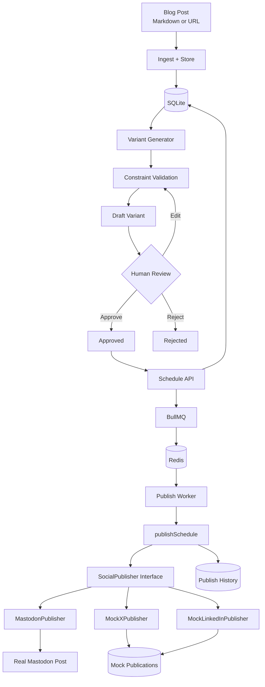

# Social Media Studio

FlyRank Backend Track Capstone.

Social Media Studio turns one stored blog post into platform-specific social media variants, validates each variant against platform rules, supports human review, schedules approved variants, and publishes each scheduled item exactly once through a configurable publisher adapter.

The project focuses on four reliability concerns:

- platform constraint enforcement
- human approval before scheduling
- adapter-based publishing
- idempotent, durable background execution

The real publishing target is Mastodon. X and LinkedIn are implemented as local mock publishers.

---

## Features

- Ingest posts from Markdown or a URL
- Store the source post in SQLite
- Generate X-style, LinkedIn-style, and Mastodon variants
- Enforce platform-specific constraints before storage
- Edit, approve, and reject variants
- Prevent unapproved variants from being scheduled
- Schedule approved variants for future publication
- Store delayed jobs in BullMQ + Redis
- Automatically publish due jobs through a background worker
- Publish to a real Mastodon account
- Publish through Mock X and Mock LinkedIn adapters
- Swap publisher adapters through environment configuration
- Use deterministic idempotency keys to prevent duplicate publishing
- Recover interrupted schedules when the worker restarts
- Record every publish attempt in visible publish history
- Simulate a worker crash safely through a mock adapter for durability testing

---

## Architecture



### Reliability flow

```text
approved variant
      ↓
schedule stored in SQLite
      ↓
deterministic BullMQ job
      ↓
Redis durable queue
      ↓
worker processes due job
      ↓
SocialPublisher adapter
      ↓
idempotency key protects retry
      ↓
publish attempt recorded
```

SQLite is the application source of truth for posts, variants, schedules, and publish history.

Redis is used as the durable BullMQ job store.

On worker startup, recoverable SQLite schedules are reconciled with BullMQ so interrupted work can continue.

---

## Tech Stack

- Node.js
- Express
- SQLite using Node's built-in `node:sqlite`
- BullMQ
- Redis
- Docker Compose
- Cheerio
- Mastodon API
- dotenv
- concurrently

Publishing adapters:

- `MastodonPublisher` — real publisher
- `MockXPublisher` — local mock
- `MockLinkedInPublisher` — local mock

---

## Project Structure

```text
flyrank-capstone-social-studio/
│
├── compose.yaml
├── package.json
├── .env.example
├── .gitignore
├── README.md
├── DESIGN.md
├── EVIDENCE.md
├── BUILDLOG.md
│
├── data/
│   └── social-studio.db
│
├── scripts/
│   └── seed.js
│
├── src/
│   ├── app.js
│   │
│   ├── config/
│   │   ├── constraintProfiles.js
│   │   ├── publisherConfig.js
│   │   └── redis.js
│   │
│   ├── controllers/
│   │   ├── posts.controller.js
│   │   ├── variants.controller.js
│   │   ├── review.controller.js
│   │   ├── schedules.controller.js
│   │   └── publish.controller.js
│   │
│   ├── db/
│   │   └── db.js
│   │
│   ├── jobs/
│   │   ├── publishQueue.js
│   │   ├── publishWorker.js
│   │   └── reconcileSchedules.js
│   │
│   ├── publishers/
│   │   ├── socialPublisher.js
│   │   ├── publisherFactory.js
│   │   ├── mastodonPublisher.js
│   │   ├── mockXPublisher.js
│   │   └── mockLinkedInPublisher.js
│   │
│   ├── routes/
│   │   ├── posts.routes.js
│   │   ├── variants.routes.js
│   │   ├── schedules.routes.js
│   │   └── publish.routes.js
│   │
│   ├── services/
│   │   ├── post.service.js
│   │   ├── url.service.js
│   │   ├── variant.service.js
│   │   ├── review.service.js
│   │   ├── schedule.service.js
│   │   └── publish.service.js
│   │
│   └── validators/
│       └── variant.validator.js
│
└── tests/
    ├── db.test.js
    ├── variant-validator.test.js
    ├── constraint-gate.test.js
    ├── publisher-adapter.test.js
    ├── mastodon-auth.test.js
    ├── redis.test.js
    ├── queue.test.js
    └── reconcile.test.js
```

Generated SQLite database files under `data/` are ignored by Git.

---

## Prerequisites

Install:

- Node.js 22 or newer
- npm
- Docker Desktop or Docker Engine with Docker Compose
- Git

For real Mastodon publishing, use a Mastodon account you own and create an application access token with permission to publish statuses.

No Mastodon token is required for the Mock X and Mock LinkedIn adapters.

---

## Installation

Clone the repository:

```bash
git clone https://github.com/Kimi-G/flyrank-capstone-social-studio.git
cd flyrank-capstone-social-studio
```

Install dependencies:

```bash
npm install
```

Create the local environment file:

```bash
cp .env.example .env
```

On Windows Command Prompt, the equivalent is:

```cmd
copy .env.example .env
```

Configure the values in `.env`.

---

## Environment Variables

Example:

```env
PORT=3000

DATABASE_PATH=./data/social-studio.db

REDIS_URL=redis://127.0.0.1:6379

MASTODON_BASE_URL=https://your-instance.example
MASTODON_ACCESS_TOKEN=replace_with_token
MASTODON_VISIBILITY=unlisted

PUBLISHER_ADAPTER_X=mock_x
PUBLISHER_ADAPTER_LINKEDIN=mock_linkedin
PUBLISHER_ADAPTER_MASTODON=mastodon

VARIANT_GENERATOR=template
```

### Publisher configuration

The application resolves publishers through configuration.

Default mapping:

```text
x        → mock_x
linkedin → mock_linkedin
mastodon → mastodon
```

For example, Mastodon can temporarily be routed through the X mock adapter without changing business logic:

```bash
PUBLISHER_ADAPTER_MASTODON=mock_x npm start
```

---

## Run the Application

The application has one main run command:

```bash
npm start
```

This command:

1. starts the Redis Docker container
2. starts the Express API
3. starts the BullMQ publishing worker

Expected startup output includes:

```text
Container social-studio-redis Running

[WORKER] [worker] Reconciliation complete: ...
[WORKER] [worker] Listening on queue "social-publish"

[API] Social Media Studio API running at http://localhost:3000
```

Keep this terminal running.

The API is available at:

```text
http://localhost:3000
```

---

## Seed Sample Data

With `npm start` still running, open a second terminal and run:

```bash
npm run seed
```

The seed script creates one sample stored blog post through the public API and generates platform variants from it.

Example:

```text
Seeding Social Media Studio through http://localhost:3000
Created sample post 5
Generated sample variants

┌─────────┬────┬────────────┬─────────┐
│ (index) │ id │ platform   │ status  │
├─────────┼────┼────────────┼─────────┤
│ 0       │ 12 │ x          │ draft   │
│ 1       │ 13 │ linkedin   │ draft   │
│ 2       │ 14 │ mastodon   │ draft   │
└─────────┴────┴────────────┴─────────┘

SEED COMPLETE
```

Running the seed command again creates another sample campaign.

---

## API Workflow

### 1. Ingest Markdown

```bash
curl -i -X POST http://localhost:3000/posts \
-H "Content-Type: application/json" \
-d '{"source_type":"markdown","title":"Reliable Publishing","content":"# Reliable Publishing\n\nReliable systems should validate content and remain safe under retries."}'
```

---

### 2. Ingest a URL

```bash
curl -i -X POST http://localhost:3000/posts \
-H "Content-Type: application/json" \
-d '{"source_type":"url","source_url":"https://example.com"}'
```

Only HTTP and HTTPS URLs are accepted.

---

### 3. Generate Variants

Replace `<POST_ID>` with the stored post ID:

```bash
curl -i -X POST http://localhost:3000/posts/<POST_ID>/variants
```

The configured generator creates:

```text
x
linkedin
mastodon
```

variants.

Each variant must pass its platform constraint profile before it is stored.

---

### 4. Retrieve Variants

```bash
curl http://localhost:3000/posts/<POST_ID>/variants
```

---

### 5. Edit a Variant

```bash
curl -i -X PATCH http://localhost:3000/variants/<VARIANT_ID> \
-H "Content-Type: application/json" \
-d '{"content":"Updated approved-safe content. #Backend #Reliability"}'
```

Edited content is validated again.

Editing previously approved content resets it to `draft`.

---

### 6. Approve a Variant

```bash
curl -i -X POST http://localhost:3000/variants/<VARIANT_ID>/approve
```

Only approved variants may be scheduled.

---

### 7. Reject a Variant

```bash
curl -i -X POST http://localhost:3000/variants/<VARIANT_ID>/reject
```

---

### 8. Schedule an Approved Variant

The scheduled time must be a valid future ISO timestamp.

Example:

```bash
curl -i -X POST http://localhost:3000/variants/<VARIANT_ID>/schedule \
-H "Content-Type: application/json" \
-d '{"scheduled_at":"2026-12-01T18:00:00.000Z"}'
```

Successful scheduling returns the SQLite schedule and the BullMQ job:

```json
{
  "ok": true,
  "reused": false,
  "schedule": {
    "id": 5,
    "variant_id": 11,
    "status": "scheduled"
  },
  "queue": {
    "job_id": "schedule-5",
    "status": "queued"
  }
}
```

The worker automatically publishes the job when its scheduled time arrives.

---

## Scheduling an Item Two Minutes Ahead

Generate a timestamp:

```bash
node -e "console.log(new Date(Date.now() + 2 * 60 * 1000).toISOString())"
```

Copy the returned timestamp and use it when scheduling:

```bash
curl -i -X POST http://localhost:3000/variants/<VARIANT_ID>/schedule \
-H "Content-Type: application/json" \
-d '{"scheduled_at":"<TIMESTAMP>"}'
```

Watch the `npm start` worker output.

Expected:

```text
[WORKER] [worker] Processing job schedule-<ID> for schedule <ID>
[WORKER] [worker] Published schedule <ID>
[WORKER] [worker] Job schedule-<ID> completed
```

For a Mastodon variant configured with the real adapter, the publish history contains the real Mastodon status URL.

---

## Unapproved Scheduling Is Blocked

Trying to schedule a draft or rejected variant returns a 4xx response.

Example:

```bash
curl -i -X POST http://localhost:3000/variants/<UNAPPROVED_VARIANT_ID>/schedule \
-H "Content-Type: application/json" \
-d '{"scheduled_at":"2026-12-01T18:00:00.000Z"}'
```

Example response:

```text
HTTP/1.1 409 Conflict
```

```json
{
  "ok": false,
  "status": 409,
  "error": "Only approved variants can be scheduled; current status is draft"
}
```

---

## Publish History

Retrieve all publishing attempts:

```bash
curl http://localhost:3000/publish/history
```

Each record includes:

- schedule ID
- variant ID
- platform
- adapter
- attempt number
- result
- external ID
- external URL
- error
- started timestamp
- finished timestamp

Possible results include:

```text
success
failed
duplicate_skipped
```

---

## Mock Publications

Mock X and Mock LinkedIn store their simulated external publications locally.

Retrieve them with:

```bash
curl http://localhost:3000/publish/mock-publications
```

These records make adapter behavior inspectable without publishing to X or LinkedIn.

---

## Manual Publish Endpoint

The scheduler normally publishes automatically.

For direct idempotency testing, an individual schedule can also be invoked manually:

```bash
curl -i -X POST http://localhost:3000/schedules/<SCHEDULE_ID>/publish
```

Repeating the request for an already published schedule does not create a second external publication.

Instead, publish history records:

```text
duplicate_skipped
```

and reuses the existing external ID and URL.

---

## Idempotency

Each schedule receives an idempotency key using:

```text
variant:<variant_id>:slot:<normalized_timestamp>
```

Example:

```text
variant:9:slot:2026-10-11T02:46:20.953Z
```

BullMQ also receives a deterministic job ID:

```text
schedule-<schedule_id>
```

This provides protection at multiple layers:

```text
same variant + same slot
        ↓
same SQLite schedule
        ↓
same idempotency key
        ↓
same BullMQ job ID
        ↓
same publisher-side effect
```

After a successful publish, another publish request is recorded as `duplicate_skipped` instead of producing another post.

---

## Durable Scheduling

Redis uses append-only persistence and a Docker volume:

```yaml
command:
  - redis-server
  - --appendonly
  - "yes"
```

The queue therefore survives Redis container restarts.

The worker also performs startup reconciliation.

Schedules with these statuses are recoverable:

```text
scheduled
processing
```

When the worker starts, those SQLite records are checked and corresponding deterministic BullMQ jobs are restored if required.

Example worker startup:

```text
[worker] Reconciliation complete: 1 recoverable schedule(s), 1 queued
[worker] Listening on queue "social-publish"
```

---

## Worker Crash Recovery Test

A controlled test hook exists to demonstrate the most dangerous failure window:

```text
publisher creates external side effect
        ↓
worker crashes
        ↓
local success transaction never commits
```

The hook is restricted to mock adapters.

Use a scheduled X variant and start the worker separately with:

```bash
SIMULATE_CRASH_AFTER_PUBLISH=true npm run worker
```

When the scheduled mock publication executes:

```text
[worker] Processing job schedule-6 for schedule 6
[publish] Simulating worker crash after external publish for schedule 6
```

The process exits intentionally.

At that point the state is:

```text
schedule → processing
attempt 1 → started
mock publication → already exists
```

Restart normally:

```bash
npm run worker
```

Expected recovery:

```text
[worker] Reconciliation complete: 1 recoverable schedule(s), 1 queued
[worker] Job schedule-6 stalled
[worker] Processing job schedule-6 for schedule 6
[worker] Published schedule 6
[worker] Job schedule-6 completed
```

Final history:

```text
attempt 1 → failed
error → Worker interrupted before attempt completed

attempt 2 → success
```

The mock publication table still contains exactly one publication for the idempotency key.

Result:

```text
2 publish attempts
1 successful finalization
1 actual publication
0 duplicate posts
```

Do not enable this fault-injection flag for normal application use.

The crash hook is additionally restricted in code to adapters whose names begin with:

```text
mock_
```

so the controlled fault test cannot intentionally crash immediately after a real Mastodon publish.

---

## Adapter Swap

Publisher selection is configuration-driven.

For example, to route a Mastodon-platform campaign through `mock_x` instead of the real Mastodon publisher:

```bash
PUBLISHER_ADAPTER_MASTODON=mock_x npm start
```

No review, scheduling, variant, or publishing business logic needs to change.

Publish history then shows:

```text
platform: mastodon
adapter: mock_x
```

---

## Tests

### Database

```bash
npm run db:test
```

### Constraint profile validator

```bash
npm run variant:test
```

### Invalid variant storage gate

```bash
npm run constraint:test
```

This proves invalid content is rejected before database storage.

### Publisher adapters and idempotency

```bash
npm run publisher:test
```

This verifies that repeated mock publishing returns the same external publication and only one mock publication row is created.

### Mastodon credentials

```bash
npm run mastodon:auth
```

Requires valid Mastodon environment variables.

The test verifies credentials without printing the access token.

### Redis

```bash
npm run redis:test
```

Expected:

```text
REDIS CONNECTION OK
{ ping: 'PONG' }
```

### BullMQ queue

```bash
npm run queue:test
```

Expected behavior:

```text
firstJobId == secondJobId
storedInRedis == true
```

### Schedule reconciliation

```bash
npm run reconcile:test
```

Expected result:

```text
QUEUE RECOVERY CHECK
missingJobs: []

RECONCILIATION OK
```

---

## Run All Core Tests

Run these individually:

```bash
npm run db:test
npm run variant:test
npm run constraint:test
npm run publisher:test
npm run redis:test
npm run queue:test
npm run reconcile:test
```

`npm run mastodon:auth` is intentionally separate because it requires real Mastodon credentials.

---

## Acceptance Probe Guide

### Probe 1 — Ingest and generate valid variants

Run:

```bash
npm run seed
```

The command creates a stored post and generates X, LinkedIn, and Mastodon draft variants that have passed their constraint profiles.

---

### Probe 2 — Rule-breaking variant is blocked

Run:

```bash
npm run constraint:test
```

Expected:

```text
BLOCKED BEFORE STORAGE
DATABASE CHECK
unchanged: true
```

The error output identifies each violated rule.

---

### Probe 3 — Unapproved schedule returns 4xx

Use a draft or rejected variant:

```bash
curl -i -X POST http://localhost:3000/variants/<VARIANT_ID>/schedule \
-H "Content-Type: application/json" \
-d '{"scheduled_at":"2026-12-01T18:00:00.000Z"}'
```

Expected:

```text
HTTP/1.1 409 Conflict
```

---

### Probe 4 — Approved variant publishes through the scheduler

1. Approve a Mastodon variant.
2. Schedule it approximately two minutes in the future.
3. Do not call the manual publish endpoint.
4. Watch the worker process the BullMQ job.
5. Retrieve:

```bash
curl http://localhost:3000/publish/history
```

The successful record contains the Mastodon external ID and live status URL.

---

### Probe 5 — Worker interruption produces no duplicate

Use the controlled mock fault:

```bash
SIMULATE_CRASH_AFTER_PUBLISH=true npm run worker
```

After the intentional crash, restart normally:

```bash
npm run worker
```

The final state contains:

```text
one failed interrupted attempt
one successful recovery attempt
one actual mock publication
zero duplicate publications
```

Full proof is recorded in `EVIDENCE.md`.

---

### Probe 6 — Adapter swap requires configuration only

Start with:

```bash
PUBLISHER_ADAPTER_MASTODON=mock_x npm start
```

Publish a Mastodon-platform variant.

The campaign is published through `mock_x` without changing business logic.

---

## Security

Secrets are stored only in `.env`.

`.env` is excluded through `.gitignore`.

The repository ships:

```text
.env.example
```

with placeholder values only.

Never commit:

```text
MASTODON_ACCESS_TOKEN
```

The repository can be checked with:

```bash
git ls-files .env
```

Expected output:

```text
(no output)
```

---

## Variant Status Lifecycle

Normal lifecycle:

```text
draft
  ↓
approved
  ↓
scheduled
  ↓
published
```

or:

```text
draft
  ↓
rejected
```

Editing approved content returns the variant to:

```text
draft
```

so it requires human approval again before it can be scheduled.

---

## Publish Attempt Lifecycle

A normal successful publish:

```text
started
  ↓
success
```

A publisher failure:

```text
started
  ↓
failed
```

An unnecessary retry after an already successful publication:

```text
duplicate_skipped
```

A worker interruption may result in:

```text
attempt 1 → failed
attempt 2 → success
```

while still producing only one external publication.

---

## Known Limitations

- The project is designed as a single-user capstone service and does not implement authentication or multi-tenancy.
- Variant generation currently uses deterministic templates rather than an AI model.
- Only Mastodon is implemented as a real social publisher.
- X and LinkedIn intentionally use mock adapters.
- Image generation, analytics, engagement tracking, and social-media metrics are outside the project scope.
- SQLite uses Node's built-in `node:sqlite`, which may display an experimental feature warning in the current Node runtime.
- The seed command creates new sample records each time it runs instead of resetting the database.
- The controlled crash hook exists only for reliability testing and should not be enabled during normal operation.
- Redis must be available for new schedule requests to be immediately queued. If queueing fails after the SQLite schedule is saved, worker reconciliation can restore recoverable schedules later.
- Editing an approved scheduled variant invalidates the SQLite schedule and prevents publication, but a previously queued BullMQ job may remain until the worker encounters it and safely rejects the missing/invalid schedule.

---

## Evidence

Detailed command transcripts and acceptance proof are available in:

[**EVIDENCE.md**](EVIDENCE.md)

Evidence includes:

- Markdown and URL ingestion
- platform constraint enforcement
- invalid variant rejection before storage
- review and approval workflow
- rejected/unapproved scheduling refusal
- adapter interface proof
- configuration-only adapter swap
- repeated publish idempotency
- real Mastodon publishing
- Redis persistence
- BullMQ deterministic jobs
- automatic scheduled publishing
- worker crash and recovery
- publish history
- secret handling

---

## Design

The original design document is available in:

[**DESIGN.md**](DESIGN.md)

It documents:

- problem statement
- data model
- API surface
- publisher interface
- initial architecture decisions
- explicit non-goals

---

## Build Log

Development and AI-assistance notes are recorded in:

[**BUILDLOG.md**](BUILDLOG.md)

---

## Main Commands

| Command | Purpose |
| --- | --- |
| `npm install` | Install project dependencies |
| `npm start` | Start Redis, API, and worker |
| `npm run seed` | Create a sample post and variants |
| `npm run api` | Start only the Express API |
| `npm run worker` | Start only the BullMQ worker |
| `npm run db:test` | Test database setup |
| `npm run variant:test` | Test platform validation |
| `npm run constraint:test` | Prove invalid content is blocked |
| `npm run publisher:test` | Test mock publishers and idempotency |
| `npm run mastodon:auth` | Verify Mastodon credentials |
| `npm run redis:test` | Verify Redis connectivity |
| `npm run queue:test` | Verify BullMQ deterministic queueing |
| `npm run reconcile:test` | Verify schedule reconciliation |

---

## Documentation

- [DESIGN.md](DESIGN.md)
- [EVIDENCE.md](EVIDENCE.md)
- [BUILDLOG.md](BUILDLOG.md)
- [.env.example](.env.example)

---

## Repository

GitHub:

```text
https://github.com/Kimi-G/flyrank-capstone-social-studio
```